# QuadRing 已实现事务说明

本文按一笔本地命令的执行过程，结合 CHI 消息、物理 Ring 路径和端点状态机，说明当前实现。通用结构见 [design.md](design.md)；这里集中回答：什么条件触发事务、每条 flit 怎么绕环、数据和权限如何变化，以及何时完成。

## 1. 图例：同一笔事务的两个视角

所有图使用默认 `ChiSystem`：RN0/Stop0、HN/Stop1、RN1/Stop2、SN/Stop3。四条单向环的方向均为：

```text
           RN0 / Stop0 ──────────► HN / Stop1
                ▲                     │
                │                     ▼
            SN / Stop3 ◄───────── RN1 / Stop2
```

**CHI 时序图**只表示端点之间的消息依赖；其中一条箭头可能包含多个物理 hop。**物理 Ring 分步图**按从左到右、从上到下阅读，每格对应一条消息：完整环上的彩色边表示该 flit 的路径，灰色边表示未经过的链路，边上的 1、2、3 是该 flit 的 hop 顺序。节点标注 `inject`、`forward`、`eject` 或 `idle`。蓝色为 REQ/channel0，绿色为 RSP/channel1，橙色为 SNP/channel2，红色为 DAT/channel3。

分步格的编号是消息顺序，不是时钟周期；一次 hop 是 `ringOut.fire` 与下一 Stop 的 `ringIn.fire`，目标 FIFO 的 `eject.fire` 是另一次本地交付。每格展示一条 flit 的完整路径，没有假定它在一个周期内走完。各环可以独立传输，但端点状态机仍有消息依赖。

### 消息、ID 和物理位置

图中的 `A` 是同一条 64 字节对齐地址，`D` 是整行数据。`t` 是 RN 的原始事务 ID，`h=0` 是 HN 下游事务 ID，`s=0` 是 HN snoop ID，`dH=dS=0` 是当前实现的 HN/SN 数据槽 ID。

| 消息 | `txnID` 的含义 |
|---|---|
| 初始 REQ、`CompData`、`CompDBIDResp`、`DBIDResp`、`Comp` | 对应请求的事务 ID；DBID 另放在 `dbID` 字段 |
| 写 DAT、`CompAck` | 收到的 DBID，标识完成方的数据槽 |
| `SnpResp`、`SnpRespData` | 收到的 snoop 事务 ID |
| `RetryAck` | 被拒绝请求的事务 ID |
| `PCrdGrant` | 固定为 0；按提供方和 `pCrdType` 匹配信用 |

HN 保存 RN 的 `(srcID, txnID)`，向 SN 发起新请求时将 `srcID` 改为 HN、`tgtID` 改为 SN、`txnID` 改为 `h`；返回 RN 时恢复 `t`。这不是同一条 flit 穿过 HN 后直接继续走。

`ChiNoC` 将 CHI 目的 node ID 映射为外层 `RingFlit.dst`；REQ/RSP/DAT 使用 `tgtID`，SNP 使用独立的 `RoutedSnp.dst`。图中 ID 恰好等于 Stop 索引；代码也支持稀疏或重排 ID。连接顺序见 [ChiSystem.scala](../src/main/scala/chi/ChiSystem.scala#L39)，映射和封装见 [ChiNoC.scala](../src/main/scala/chi/ChiNoC.scala#L27)，字段见 [ChiFlit.scala](../src/main/scala/chi/ChiFlit.scala)。

### 每一跳发生什么

```text
                                  dst == local
ringIn → FIFO head ────────────────→ local.eject → endpoint
                 └── dst != local → ringOut → 下一 Stop 的 FIFO
local.inject ─────────────────────→ ringOut
```

只有环输入进入本 Stop 的 FIFO，本地注入绕过本 Stop FIFO；下一 Stop 收到后仍要入队，不会组合穿过它的 FIFO。转发优先于注入，转发需至少 1 个下游空槽 credit，注入需至少 2 个，以保留 bubble。任意 FIFO dequeue 都向上游返回一个 credit，下一周期才可用。目标不接收时，该 FIFO 的后续 flit 不能越过队头。

对应实现为 [RingStop.scala](../src/main/scala/noc/RingStop.scala#L18)、[Ring.scala](../src/main/scala/noc/Ring.scala#L16)、[QuadRing.scala](../src/main/scala/noc/QuadRing.scala#L20)。例如 HN→RN0 必须走 `Stop1 → Stop2 → Stop3 → Stop0`；中间经过 RN1 或 SN 的 Stop，并不表示其 endpoint 收到了该消息。

## 2. 本地命令和缓存命中

[RnPort.scala](../src/main/scala/chi/RnPort.scala) 暴露 `{write, addr, data, txnID}` 和 `{txnID, data}`。每条命令访问完整 64 B，DAT 一条 flit 携带全部 512 bit；写结果的 `data=0`。每个 RN 一次接受一条本地命令，HN 一次执行一笔活动事务。HN 保存的 retry 快照用于核对重发，不能自动作为已接受事务执行。

默认 `coherent=false`，本地读写分别选择 `ReadNoSnp`、`WriteNoSnpFull`。启用 `coherent=true` 后，RN 使用直接映射缓存：

| 状态 | 含义 | 本地读 | 本地写 |
|---|---|---|---|
| I | 无有效副本 | `ReadShared` | `ReadUnique` |
| SC | 共享、干净 | 本地返回 | `ReadUnique` 获取独占权 |
| UC | 独占、干净 | 本地返回 | 本地修改，变 UD |
| UD | 独占、脏 | 本地返回 | 本地修改，保持 UD |

命中路径是 `idle → returnResult → idle`，**没有任何 Ring flit**。缺失时先检查是否需要替换 victim，再发网络请求。选择代码见 [RnNode.scala](../src/main/scala/chi/RnNode.scala#L85)。HN 目录的 UC 表示独占权限，RN 可以静默从 UC 变 UD，因此目录不精确记录 dirty 状态。

## 3. 非一致性读：ReadNoSnp

前提：非一致性模式，RN0 读取地址 A，SN 内存已有 `M[A]`。

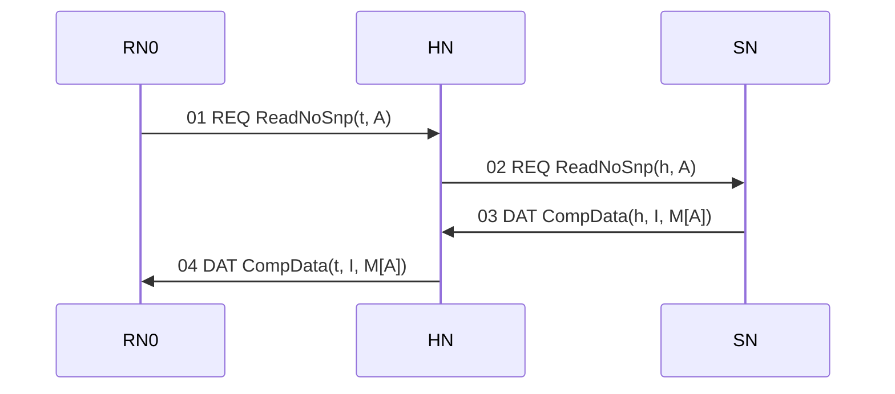

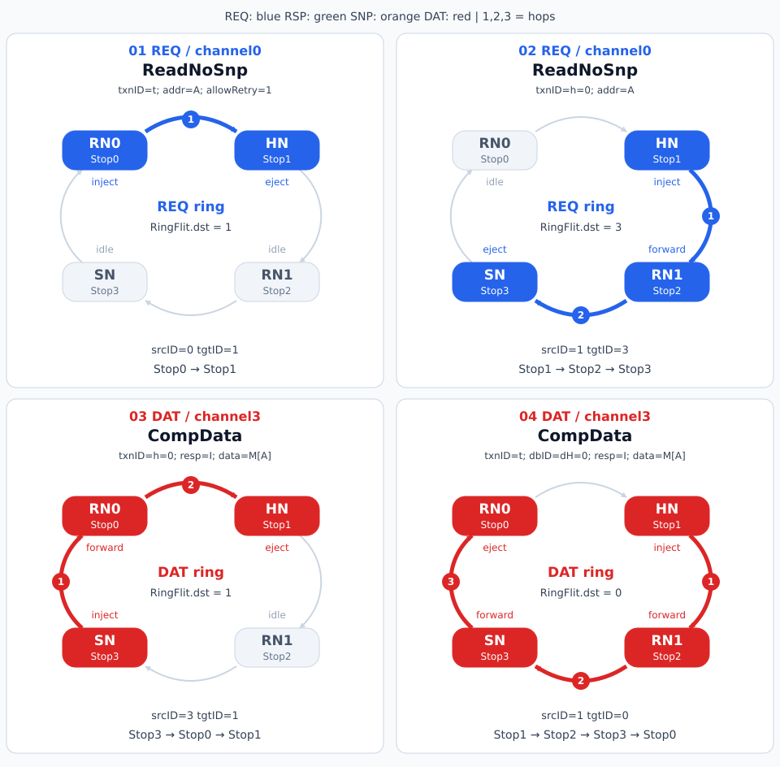

第 02 格经过 RN1/Stop2，但只在 SN/Stop3 弹出。第 03 格从 SN 经 RN0/Stop0 回 HN；第 04 格由 HN 新发一条 DAT，经 RN1、SN 回 RN0。

| 端点 | 实际状态和动作 |
|---|---|
| RN | `idle → sendReq → waitData → returnResult`；保存本地 ID，收到 CompData 后提供整行结果 |
| HN | `idle → sendSnReq → waitSnData → sendRnData → idle`；保存上游身份，收下游数据后重新发给 RN |
| SN | `idle → readLine → sendData → idle`；读取并发送内存线 |

RN 接收数据见 [RnNode.scala](../src/main/scala/chi/RnNode.scala#L187)，HN 下游请求和返回数据分别见 [HnNode.scala](../src/main/scala/chi/HnNode.scala#L261) 的 `reqTx` 和 [同文件的 `datTx`](../src/main/scala/chi/HnNode.scala#L436)，SN 读内存见 [SnNode.scala](../src/main/scala/chi/SnNode.scala#L84)。此路径没有 CompAck。

## 4. 非一致性写：WriteNoSnpFull

前提：非一致性模式，RN0 将地址 A 的整行替换为 D。

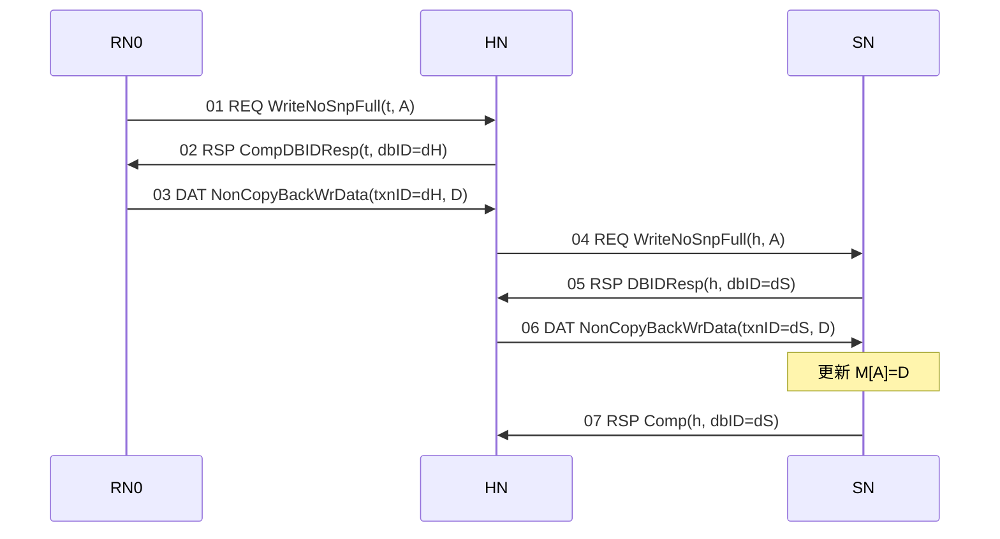

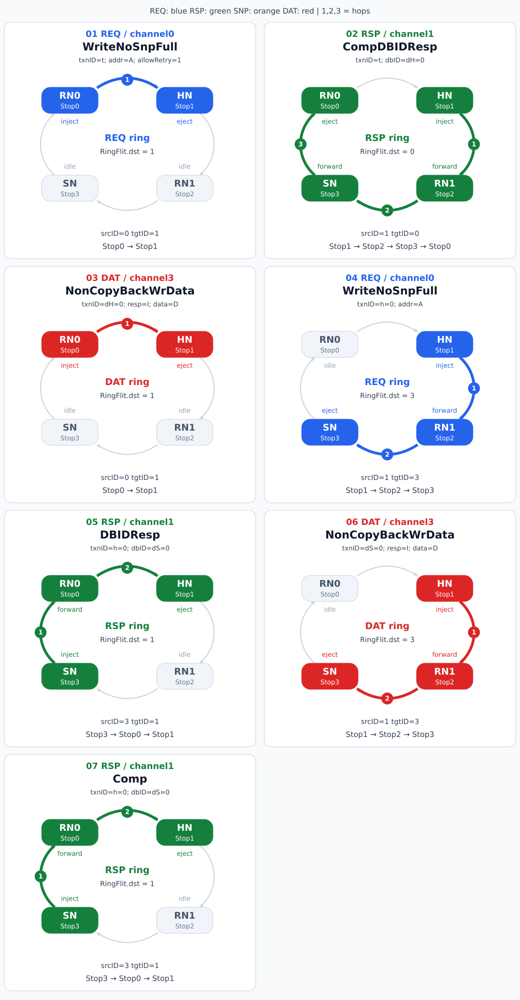

第 02 格的授权走 RSP 环，绕 `1→2→3→0`；第 03 格的写数据走 DAT 环，只走 `0→1`。第 04/06 格走 `1→2→3`，第 05/07 格则走 `3→0→1`。不同方向的协议箭头始终使用相同的单向 Ring 连接。

RN：`sendReq → waitDbId → sendWriteData → returnResult`。HN：`sendRnRsp → waitRnData → sendSnReq → waitSnDbId → sendSnData → waitSnComp → idle`。SN：`sendDbId → waitWriteData → writeLine → sendComp`。

**本地提前完成有明确边界：**RN 在第 03 条 DAT 成功注入网络后即可提供本地结果，此时 HN 可能还未 eject 该数据，SN 也可能尚未写入。HN 一直等待第 07 条 Comp 到达后才释放上下文。代码见 [RnNode.scala](../src/main/scala/chi/RnNode.scala#L245)、[HnNode.scala](../src/main/scala/chi/HnNode.scala#L425)、[SnNode.scala](../src/main/scala/chi/SnNode.scala#L124)。

## 5. 一致性读缺失：没有其他持有者

前提：`coherent=true`，RN0 的 A 为 I，HN 目录没有其他持有者。`ReadShared` 在这里可以取得 UC，并不必然返回 SC。

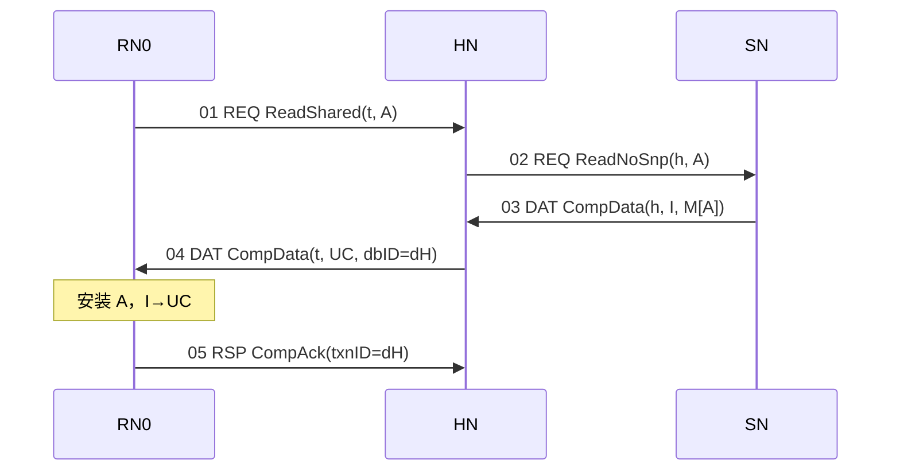

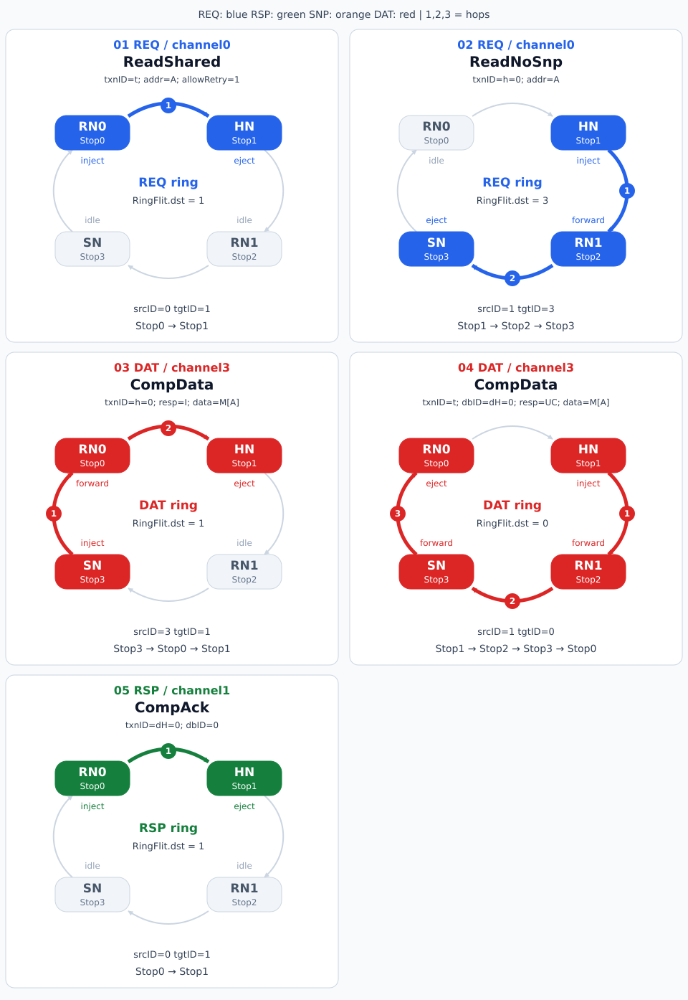

前四条路径与非一致性读对应；新增第 05 格的 RSP 环确认 `0→1`。RN 在 `waitData` 安装缓存线，再经 `sendCompAck → returnResult` 提供本地结果；HN 在 `sendRnData → waitRnCompAck` 等待确认到达。RN 注入 CompAck 和 HN 收到它是两个不同事件，本地结果反压不会阻止已注入的确认继续沿环前进。

安装和发送确认见 [RnNode.scala](../src/main/scala/chi/RnNode.scala#L162) 的 `datRx.fire`、`mainRspTx`；HN 完成匹配见 [HnNode.scala](../src/main/scala/chi/HnNode.scala#L396)。

## 6. Snoop：另一 RN 持有缓存线

本节固定 RN0 为请求者、RN1 为被 snoop 方。HN 的 `sendSnp → waitSnpResponse` 驱动 SNP 环；RN 的独立 `snoopPending` 缓冲允许其在本地命令或结果等待期间响应 snoop。

| RN1 原状态 | SnpShared：响应 / 新状态 | SnpUnique：响应 / 新状态 |
|---|---|---|
| I | RSP SnpResp(I) / I | RSP SnpResp(I) / I |
| SC 或 UC | RSP SnpResp(SC) / SC | RSP SnpResp(I) / I |
| UD | DAT SnpRespData(SC_PD) / SC | DAT SnpRespData(I_PD) / I |

`PD` 表示转交脏数据责任。SC_PD、I_PD、UD_PD 是消息的 `resp` 编码，与 RN 内部缓存状态的编码分开。状态变化和响应选择见 [RnNode.scala](../src/main/scala/chi/RnNode.scala#L297)，HN 处理见 [HnNode.scala](../src/main/scala/chi/HnNode.scala#L318)。

### 6.1 干净持有者：SnpShared + SnpResp

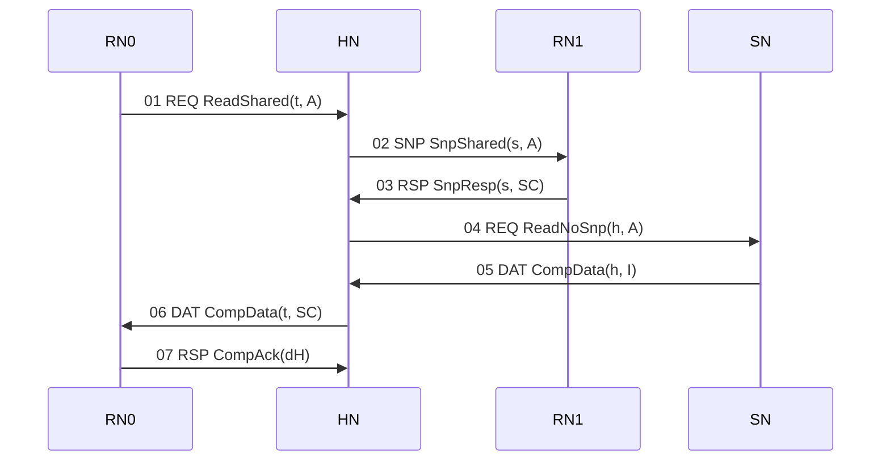

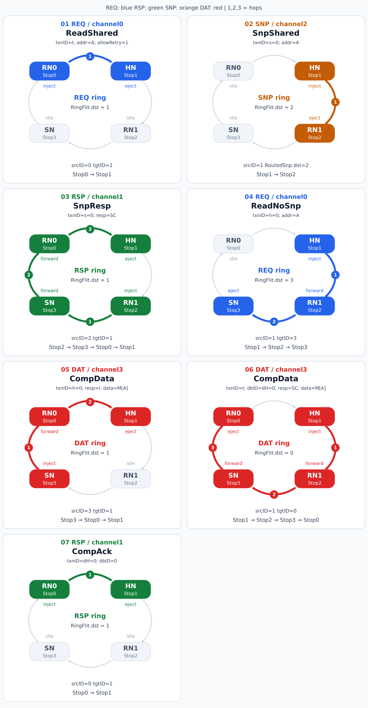

第 02 格的 SNP 只走 `1→2`，第 03 格的 SnpResp 走 RSP 环 `2→3→0→1`，没有携带缓存数据。HN 随后从 SN 获取数据；最终 RN0/RN1 均为 SC，SN 保存最新值。

### 6.2 脏持有者：SnpShared 先清理到 SN

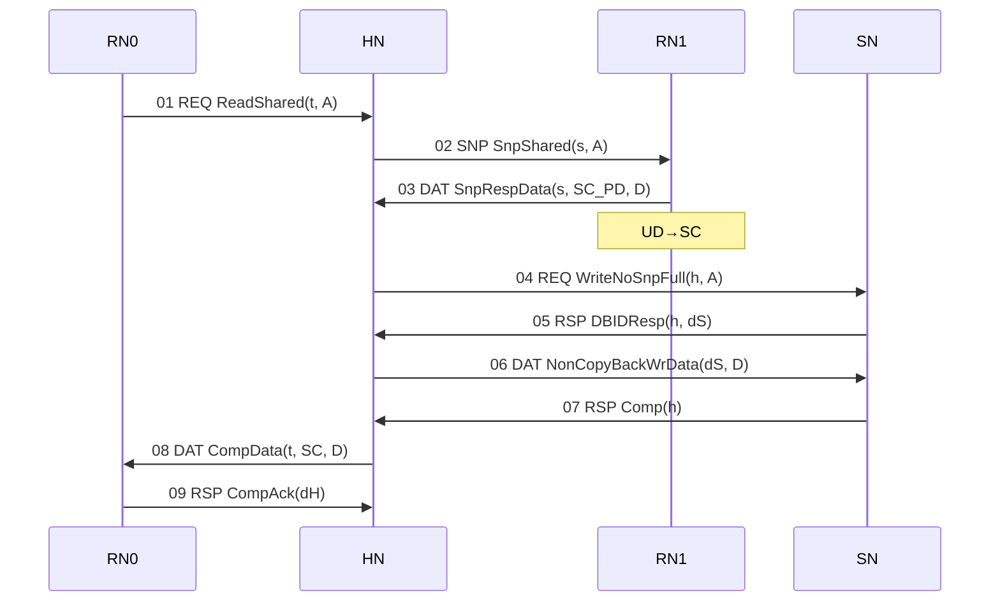

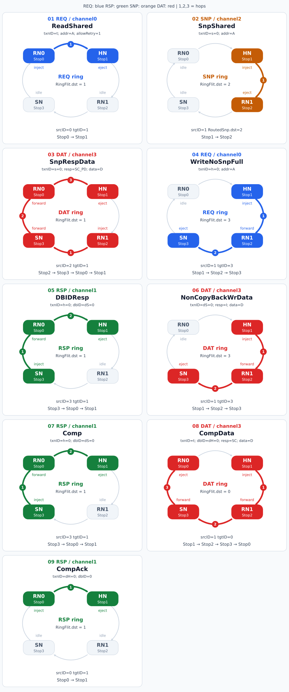

第 03 格与干净路径的 RSP 响应走相同 Stop 序列，但使用独立的 DAT 环。HN 在 `data` 暂存 D，设置 `snoopWrite`，执行第 04～07 格的下游写；收到 SN 的 Comp 后才返回 CompData。此路径不再先从 SN 读旧值。最终 RN0/RN1 为 SC，`M[A]=D`。

### 6.3 独占获取：SnpUnique 转交脏数据

本地写缺失或写命中 SC 选择 `ReadUnique`。下面假设 RN0 写入新值 W，而 RN1 当前为 UD、持有旧值 D。

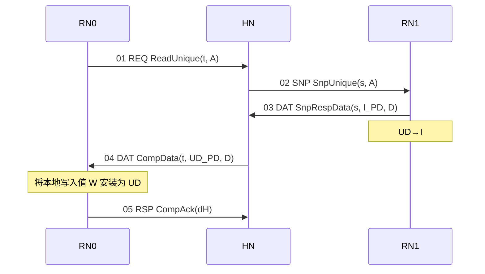

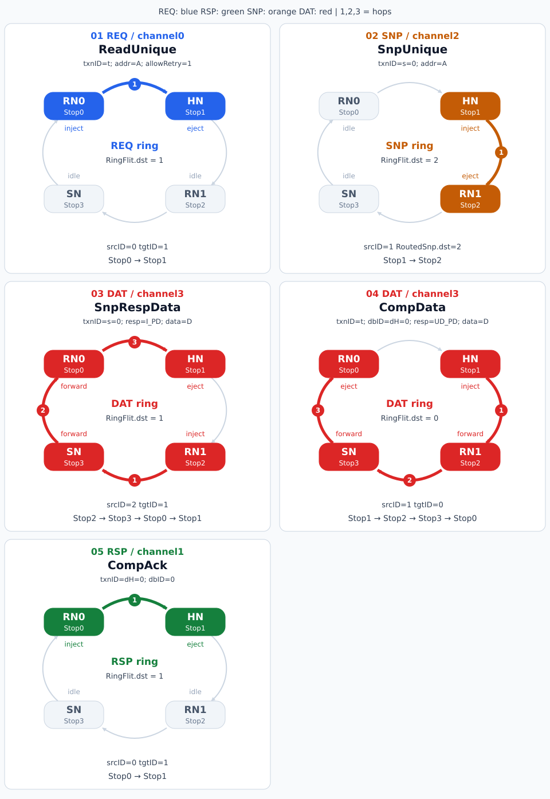

这里没有 SN 内存读写。第 03 格是 `RN1→SN Stop→RN0 Stop→HN`；第 04 格是 `HN→RN1 Stop→SN Stop→RN0`。两次数据传输都经过 SN/Stop3，但都不会 eject 到 SN endpoint。所谓“直接转交”指不写回 SN，数据仍经过 HN。

RN 在接收 CompData 时用 `request.data=W` 安装 UD，保留唯一写权限，旧数据 D 不覆盖 W。实现见 [RnNode.scala](../src/main/scala/chi/RnNode.scala#L175)。若没有其他持有者，ReadUnique 使用第 5 节的内存路径，HN 返回 CompData(UC)；若另一方干净，则 SnpUnique 得到 SnpResp(I) 后从 SN 取数据，HN 同样返回 CompData(UC)。这两种情况下 RN 都因本地写把数据安装为 UD。三种路径都以 CompAck 结束。

## 7. 缓存替换：Evict 与 WriteBackFull

同一索引访问不同 tag 时，RN 保存原始命令，先将 victim 从缓存移除。替换请求与原访问是两笔协议请求，独立处理 retry；完成替换的 RN 发送阶段后，`resumeRequest()` 发起原访问。选择和 victim 保存见 [RnNode.scala](../src/main/scala/chi/RnNode.scala#L102)。

### 7.1 干净 victim：Evict，无 DAT

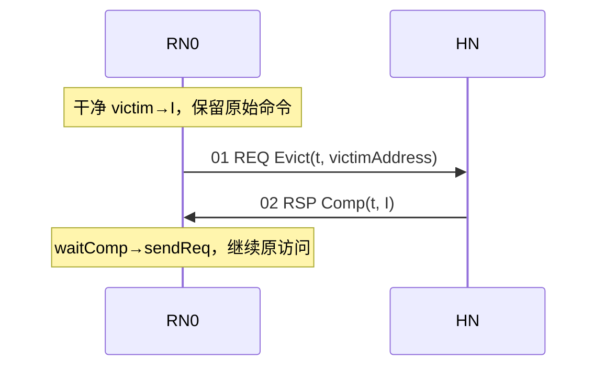

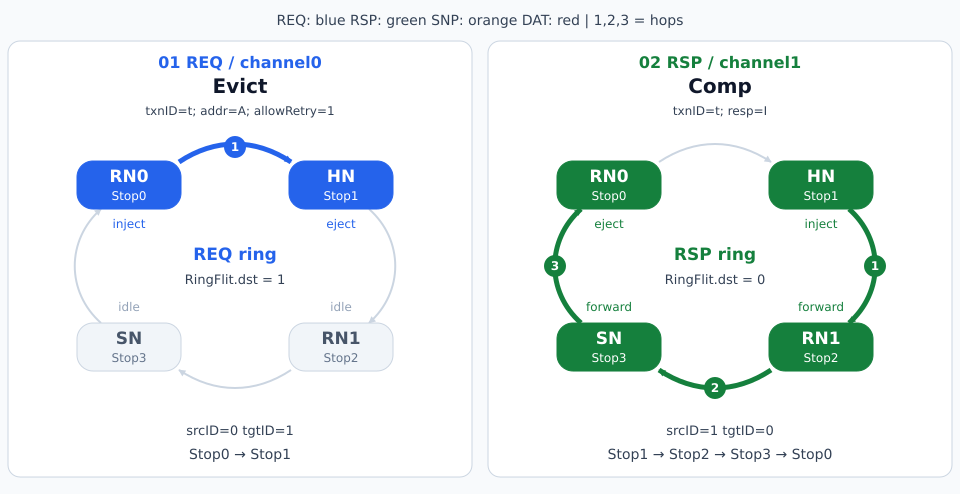

HN 清除该 RN 的目录项并发送 Comp，没有 SN 访问和 CompAck。这是当前已实现的无数据事务实例。

### 7.2 脏 victim：WriteBackFull

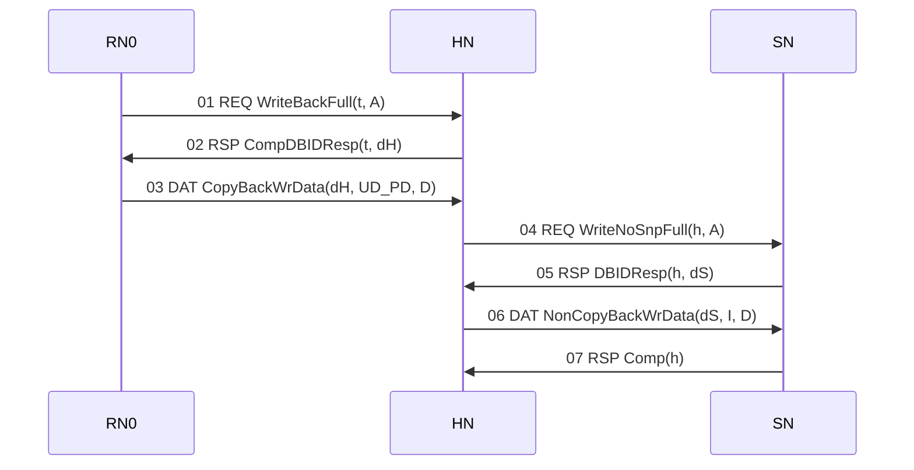


第 03 格传输前，脏数据保留在 `victimData`；HN 验证写回方拥有唯一权限，再清除相应目录项。RN 注入写回 DAT 后即可重发原访问，HN 此时仍可能在等待 SN；原访问因此可能被 RetryAck 拒绝。校验和写回见 [HnNode.scala](../src/main/scala/chi/HnNode.scala#L342)。

未获授权的 victim 被 snoop 时，RN 发送 SnpRespData(I_PD) 并清除 `victimDirty`；这同时适用于 SnpShared 和 SnpUnique，victim 不保留共享副本。原 WriteBackFull 仍需完成授权和数据阶段，随后发送 `CopyBackWrData(I, data=0)`；HN 消耗这条 DAT 并丢弃，不再写 SN。取消的写回仍有 DAT flit，不能归类为整个事务无数据。若 SnpShared 取得的是这种 victim，HN 最终给新请求者 UC，而非第 6.2 节驻留副本场景的 SC。

## 8. Retry：协议资源与 Ring credit 分开

P-Credit 预留的是 HN/SN 的事务资源，Ring credit 统计的是下一 Stop 的 FIFO 空位。请求方拿到 P-Credit 后，仍需等待 REQ 环的 `inject.ready`。

### 8.1 RN→HN：忙时拒绝，空闲后预留再重发

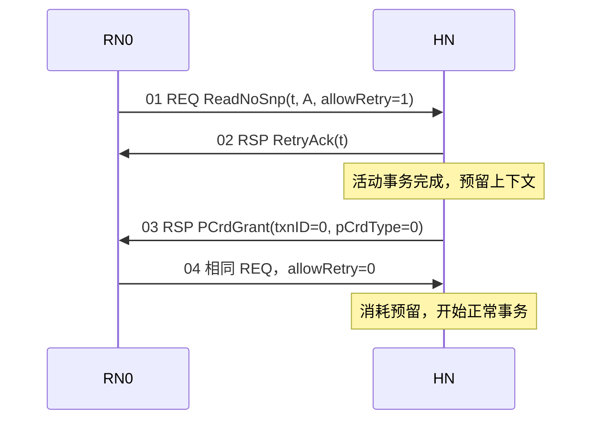

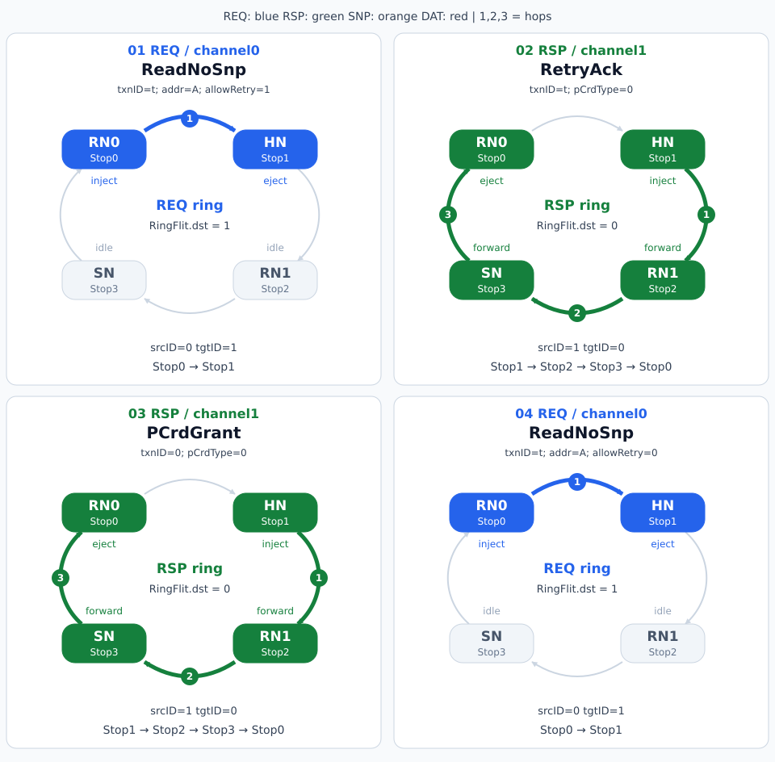

第 02/03 格均在 RSP 环上走 `1→2→3→0`。两条响应分别设置 RN 的 `retryAckSeen` 和 `creditHeld`，只有二者同时为真才重发；请求方逻辑兼容两者任意到达顺序。保存的是同一 `srcID/tgtID/txnID/opcode/addr`，重发的 `allowRetry` 改为 0，`pCrdType` 仍为 0。

HN 默认有两个等待槽，同一请求方不能重复登记。空闲时从等待表轮询选择并预留活动上下文，然后发送 PCrdGrant、等待匹配 REQ。满槽等不能登记的情况通过 ready 反压。HN 可接收并拒绝其他首次请求，避免只等一个获 grant 的重发而被 REQ 队头阻塞。

对应 RN 的 `waitingForReply/retryReady` 见 [RnNode.scala](../src/main/scala/chi/RnNode.scala#L198)，HN 准入和预留见 [HnNode.scala](../src/main/scala/chi/HnNode.scala#L181) 的 `reqRx`、`reservedRetry`、`sendGrant`、`waitRetryReq`。

### 8.2 HN→SN：独立的一组 retry 状态

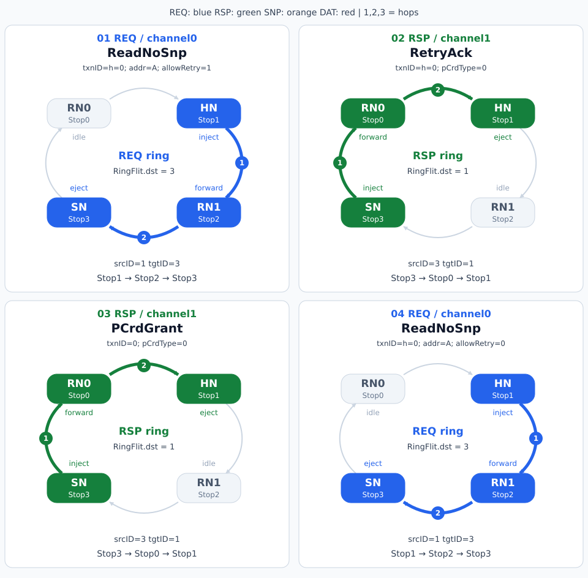

这里请求方换成 HN：REQ 走 `1→2→3`，RetryAck/PCrdGrant 走 `3→0→1`；重发使用 HN 下游 ID `h=0`。HN 保留原 RN 上下文，但 SN 的 RetryAck 不会直接转发给 RN。SN 有一个等待槽，空闲后 `sendGrant → waitRetryReq`。实现见 [SnNode.scala](../src/main/scala/chi/SnNode.scala#L48)。

当前 ChiSystem 只有一个全局串行 HN，不会自然制造多个 HN 对 SN 的竞争；SN retry 支持由独立端点测试验证，例如 [RetryAdmissionSpec.scala](../src/test/scala/chi/RetryAdmissionSpec.scala#L140)。以上 retry 图画到重发，之后接回对应的正常读写流程；REQ 各 opcode 可以重试，RSP/SNP/DAT 不使用 RetryAck。

## 9. Dataless 与完成边界

应区分“整笔事务没有 DAT”和“某条控制消息不携带数据”。当前 Evict/Comp 是完整无 DAT 路径；SnpResp、CompAck、RetryAck、PCrdGrant、DBIDResp 等控制消息也不携带数据，但它们可以属于带 DAT 的读写事务。当前没有实现 CleanUnique/MakeUnique 等其他 dataless 请求。

| 场景 | 是否出现 DAT | 关键区别 |
|---|---|---|
| 干净替换 Evict→Comp | 否 | 不访问 SN |
| 干净 snoop 的 SnpResp | 响应本身没有；随后读事务有 CompData | RSP 与 DAT 使用不同环 |
| 脏 snoop 的 SnpRespData | 有 | 使用 DAT 环转交脏数据责任 |
| RetryAck/PCrdGrant | 这两个响应没有；重发后取决于原请求 | 不把重试快照自动当作已执行事务 |
| 写数据授权 DBIDResp/CompDBIDResp | 授权本身没有；后续有写 DAT | 授权不表示内存已更新 |
| 取消的 WriteBackFull | 有 CopyBackWrData(I, 0) | 无有效脏数据，但仍有物理 DAT flit |

“提供本地结果”指 RN 进入 returnResult、拉高 response.valid；调用方只有在 response.fire 时才真正取走结果。

| 操作 | RN 可提供本地结果/继续原访问 | HN 释放活动上下文 |
|---|---|---|
| 本地缓存命中 | 本地读出或更新后 | 不涉及 HN |
| 非一致性读 | 收到 CompData 后 | 向 RN 注入 CompData 后 |
| 非一致性写 | 向网络注入写 DAT 后 | 收到 SN 的写完成 Comp 后 |
| 一致性缺失读/写 | 安装数据并向网络注入 CompAck 后 | 收到 RN 的 CompAck 后 |
| Evict 替换 | 收到 Comp 后重新发送原访问 | 清除目录项并注入 Comp 后 |
| WriteBackFull 替换 | 向网络注入 victim DAT 后重新发送原访问 | 收到 SN Comp，或消耗取消 DAT 后 |

## 10. 范围、验证入口与图源

本文针对当前整行、单活动事务的 CHI 子集。未包含部分写、SD、CleanUnique/MakeUnique、直接内存传输、转发 snoop、错误恢复和完整 CHI 链路层。复位清除未完成事务、缓存、目录和 Ring FIFO，并恢复 SN 初始内容，不保留脏缓存数据。

| 场景 | 测试入口 |
|---|---|
| 非一致性读写 | [ChiSystemSpec.scala](../src/test/scala/chi/ChiSystemSpec.scala) |
| 缓存命中、共享与替换 | [ChiCoherentSystemSpec.scala](../src/test/scala/chi/ChiCoherentSystemSpec.scala) |
| 共享与独占 snoop | [HnSharedSnoopSpec.scala](../src/test/scala/chi/HnSharedSnoopSpec.scala)、[HnUniqueSnoopSpec.scala](../src/test/scala/chi/HnUniqueSnoopSpec.scala) |
| victim 写回竞争 | [RnSnoopSpec.scala](../src/test/scala/chi/RnSnoopSpec.scala#L399) |
| RetryAck、PCrdGrant 和重发 | [RnRetrySpec.scala](../src/test/scala/chi/RnRetrySpec.scala)、[HnRetrySpec.scala](../src/test/scala/chi/HnRetrySpec.scala)、[RetryAdmissionSpec.scala](../src/test/scala/chi/RetryAdmissionSpec.scala) |

物理图源为 [render_transactions.py](diagrams/render_transactions.py)，只依赖 Python 标准库。修改场景消息或拓扑后运行 `python3 docs/diagrams/render_transactions.py` 重建 SVG；图中路径统一按 `0→1→2→3→0` 计算，避免人工绘图出现逆向箭头。
